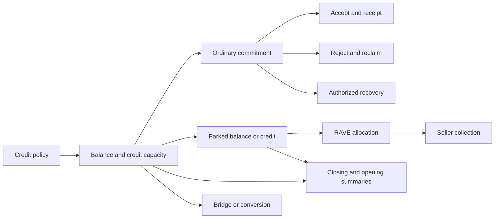

# Native authority and economic exits

**Scope.** The release tested is Sandbox v0.117.0 on Holochain 0.7.1 with disposable DNA properties. It bundles actual integrity and coordinator WASMs. Its tagged submodule is **unytco/unyt-app** d2fa9c58c51a6a5f4aac8e7c6986bc2cc1ea1fdf. The public rave_engine 0.15.0 archive identifies implementation commit 753eb97c474b7c180c403bd26231e47a03ba52b9. The public crate and templates provide code-level evidence. Equivalence of the entire private validator to that source is unverified. At inspection the public default branch had advanced to b407884 (“pin unyt to the 1.0.0 app”), submodule 6d67277f91606cc8519e82d9e6e39e5d24aab06e. The voucher service configuration also changed. The highest observed v-tag remained v0.117.0. Neither private revision returned the requested integrity source through the GitHub contents interface (404). No 1.0.0 runtime conclusions follow from this experiment. [Release](https://github.com/unytco/unyt-sandbox/tree/a636558e2da4d0b4a01182c6dfa5e615cae9a055) · [Ref observations](results/refs.txt) · [Tag inventory](results/release-tags.txt)

An agent key authorizes actions on a chain. Economic capacity additionally depends on the accepted prefix, pinned unit definitions, reservations, fees, and applicable credit policy. The public engine's Ledger::on_chain walks a specified ancestry to its newest valid ledger carrier. Ledger::carried_by reads balance, proposed_balance, fees_owed and carry_forward_units from ordinary entries or parked balance/credit tags. The formal capacity variable in this phase abstracts that accounting. It cannot be computed simply by adding all balances or ignoring fee policy. The observed founder had special credit, committed ten, and the buyer accepted ten before parking. The first nine preceding buyer actions and parked tip bind this historical reservation to the configured DNA. [Public crate source](https://docs.rs/crate/rave_engine/0.15.0/source/src/types/ledger/mod.rs) · [Offline checks](results/ancestry-audit.txt)

| Transition and actor | Dependencies and local enforcement evidence | Incompatible recognition or reversal question |
|---|---|---|
| Payer capacity → proposal / counterproposal / direct commitment | TxStateManager distinguishes negotiating history, direct commitment, proposal-based commitment, fees and proposed balance. Agent signs. Integrity binary contains distinct proposal and commitment handlers. | Competing debits, credit capacity and fee obligations on other accepted ancestries. An action ID comes after the economic choice. |
| Commitment → acceptance or rejection by counterparty → receipt / reclaim by appropriate party | Accept binds commitment. NegHistory resolves proposal versus commitment history. Reclaim references a rejection; tests check returned units and retained fee. Native fixture separately exercised reject and reclaim. | An accept on the observed history bars rejection under that history's rules. No shared offline adjudication of all competing histories established. |
| Capacity → parked balance / parked credit | Spender signs CreateLink. ParkedSpendData carries role, amount, fee, definition, lane refs, new balance and carried units. Actual link base bound sale agreement. Integrity paths cover create and delete. | Reservation and ordinary debit must contend for underlying capacity. A signed link deletion and a financial refund have different semantics. A universal parked-spend refund API was not established. |
| Parked links → execution → allocation | Authorized executor, pinned template, agreement, consumed links, global definition and inputs. Public engine computes output and previous-execution state. Native RAVE emitted the named seller and amount. | A well-formed RAVE on one execution history does not settle competing executions or prove every related liability was fenced. Check uniqueness of consumption and non-revisability under release validators. |
| Allocation → collected credit | Beneficiary's receipt references ExecutionInstance and amount. The fixture verified authors, entry hashes, allocation link and seller's +10 balance delta. | Collection materializes an entitlement. Need exact duplicate-collection exclusion per allocation and independent survival of the credit after fork adjudication and migration. |
| Rejection / recovery / fee settlement | Ordinary ReclaimInput takes a rejection. System unit recovery uses closed-counterparty evidence or non-agent-key evidence, models one recovery per carried set and raises the recovery agent's credit. Fee collection has special authority. | Customer-service restitution, reclaim of commitment, deletion of parked link and return of NFT are four different operations. A new recovery agreement has its own carried state. |
| Credit-limit change, unit/definition or conversion changes | Agreement outputs may change credit limits. Global and lane definitions supply policy. Release exports update operations and fee functions. | A limit reduction requires an explicit treatment of outstanding reservations. Repricing, accounting denominations and external redemption can change economic meaning even if an old record remains authentic. |
| Old chain → closing summary / CloseChain → opening state | Agent proposes close; threshold notaries attest a close action and payload. Frozen public migration v0_2 carries source/target DNA, agent, chain top, opening and closing balances, summary of spend links/receipts and agreement carryover including locked units. Successor pins predecessor notaries through global definition. | Need a source-wide export that excludes liabilities on alternate ancestries and all further recognized old exits. An attestation of one close lacks that statement without further rules. |
| Bridge deposit, conversion and withdrawal | Release exposes bridge initiation and scheduled withdrawal collection; its network configuration names a separate vault and chain. | External custody and confirmation rules enter the recognition contract. These routes were not executed; no redemption or all-path exclusion proof established. |
| Delegation | Application roles include designated executor and authorized spenders. | No general transferable native spending-capability contract was verified. Avoid treating agreement execution authority as unrestricted control of another agent's balance. |

The release binary contains diagnostic source paths for validation.rs, states/tx_processor.rs, entries/{proposal,commitment,accept,reject,reclaim,receipt,rave}, and links/parked_link/{mod,delete}. This is direct evidence of integrity-side code, but debug strings do not prove a rejection is reachable, complete or global. A coordinator can omit its own preflight checks. Only independently applied integrity rules and a common economic recognition policy count toward unconditional exclusion. Missing contracts include how forks affect *already collected* credit, whether every exit consumes the same version, how old liability survives migration, and which party bears losses. [Integrity path inventory](results/integrity-paths.txt) · [Migration service](https://github.com/unytco/migration-service/tree/d8a244d760bcfa1ecc92ebc900f00ab1c5ff80c8) · [Template sources](https://github.com/unytco/smart_agreement_library/tree/be2d630a3f3861c66b1b2ee341ff1c76b28210b8/library)

Conflicts include any set of debits exceeding remaining capacity, incompatible answers to a single commitment, duplicate allocation collection, two migrations of the same obligations and an old exit competing with a migrated one. The graph represents authenticated paths and dependencies rather than proof that any two paths actually conflicted. Arbitrary policy updates, operator actions and future DNAs remain outside a fixed recognition contract until explicitly admitted.

The host-level distinction is explicit in the pinned crate. In holochain_zome_types 0.7.1, ChainStatus::Valid describes the highest action integrated from **this authority's perspective**. ChainFork notes that peers may report different conflicting pairs. In hdi 0.8.1, must_get_agent_activity makes a hash-bounded chain range a validation dependency. These interfaces can support deterministic validation of supplied history and later accountability. Neither interface defines restitution or an irreversible entitlement in an economic DNA. The release WASMs also contain source paths for zfuel 0.9.1 and holochain_integrity_types 0.7.1 alongside relative crates/rave_engine paths. They do not identify the embedded engine revision uniquely. [ChainStatus source](https://docs.rs/crate/holochain_zome_types/0.7.1/source/src/query.rs) · [HDI chain dependencies](https://docs.rs/crate/hdi/0.8.1/source/src/chain.rs)

The public ParkedLinkStanding type distinguishes Parked, Unparked, NotAParkedLink and NotHeld. In the release fixture, both agents observed Unparked after successful collection. This supplies a real counterexample to using that enum variant as an exclusion proof. A standing observation is neither a financial reclaim nor a durable abort decision. [Funded standing control](results/standing.txt)
